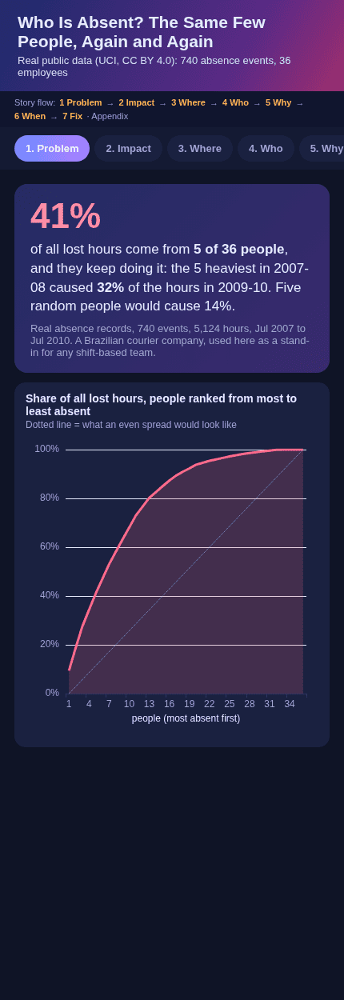
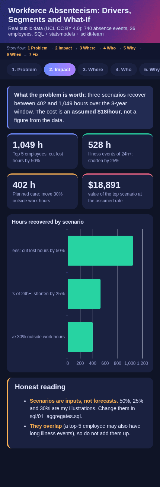
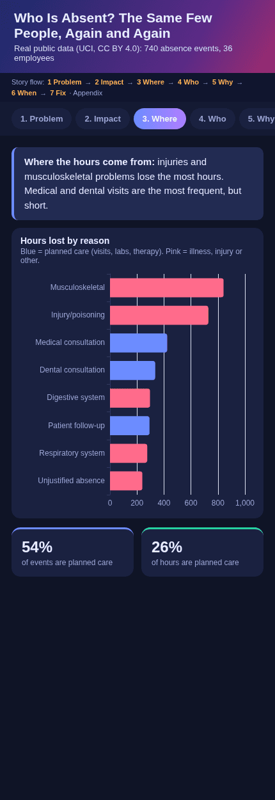
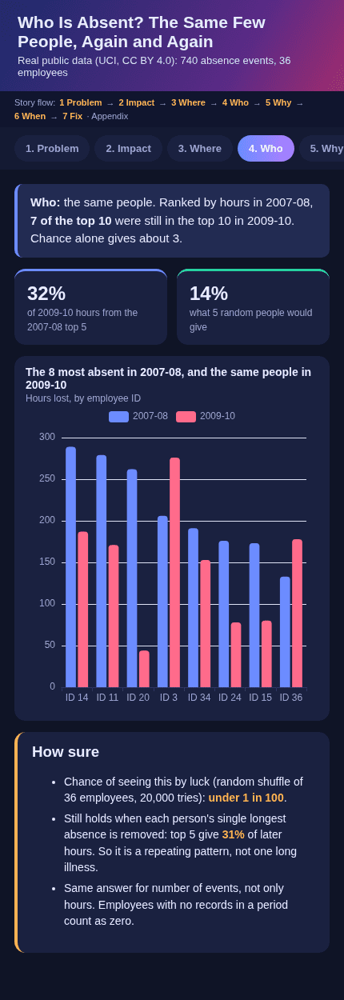
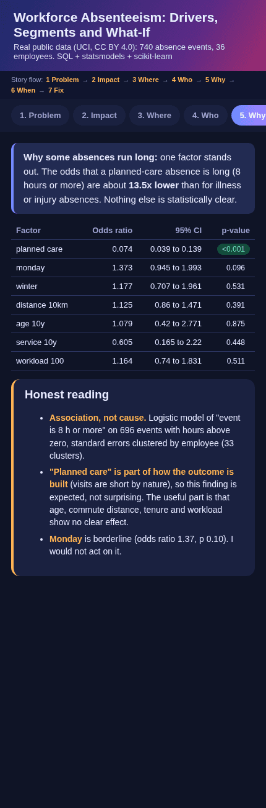
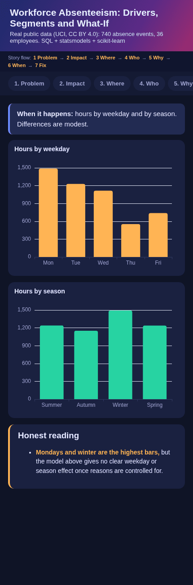
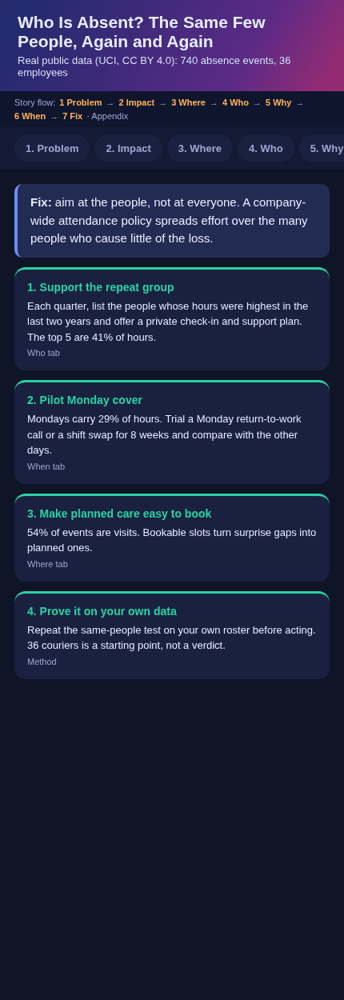
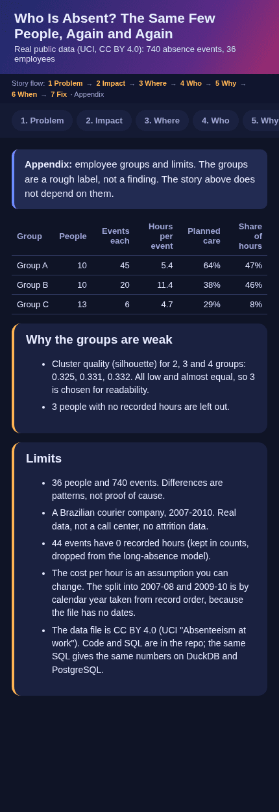

# Who Is Absent? The Same Few People, Again and Again

<p align="center"></p>

**Live dashboard (works on a phone):** https://anas-abdelhafeez.github.io/hr-absenteeism-analysis/

**One finding:** 5 of 36 people cause 41% of all lost hours, and they are largely the same people two years later. The 5 heaviest in 2007-08 caused 32% of the hours in 2009-10. Five random people would cause 14%.

Story flow: Problem -> Impact -> Where -> Who -> Why -> When -> Fix, plus an appendix.

## What the data says
| Question | Answer | How sure |
|---|---|---|
| Problem | 5 people = 41% of 5,124 lost hours | Range 32% to 52% when resampling 36 people |
| Who | The 2007-08 top 5 cause 32% of 2009-10 hours (14% by chance). 7 of the top 10 repeat (about 3 by chance) | Chance of this by luck: under 1 in 100. Holds after removing each person's longest absence (31%) |
| Why | Age, commute, years at the company, children, BMI, travel cost and workload do not explain it | All links within +/-15%, none clear |
| When | Monday is 22% of absences but 29% of hours | Chance by luck: under 1 in 100. Without the top 5 people it is 26% |
| Where | Injuries and musculoskeletal problems lose the most hours. Planned care is 54% of events and 26% of hours | |
| Impact | Cutting the top 5 people's hours by 50% recovers about 1,050 hours over 3 years | The cost per hour is an input you set, not data |

## Data
UCI "Absenteeism at work" (archive.ics.uci.edu): 740 absence events, 36 employees, July 2007 to July 2010, a Brazilian courier company. License: CC BY 4.0 (attribution kept). `data/absences.csv` is that file with readable labels, a `reason_group` column (planned care or other) and `year` / `period` columns. The file has no dates, so the year comes from record order (months restart in order). 3 events have no month and are left out of timing questions.
**This is real data but not a call center.** It is a stand-in for any shift-based team. There is no attrition data.

## Honest limits
- 36 people and 740 events. Patterns, not proof of cause.
- The cost per hour is an assumption (default $18) and the cut percentage is a slider, not a forecast.
- "No clear link" for personal traits means no evidence at this sample size, not proof of no effect.
- The employee groups in the appendix are weak (cluster quality 0.33, nearly equal for 2, 3 and 4 groups). They are a rough label and the story does not rely on them.
- 44 events have 0 recorded hours. They count as events but are dropped from the long-absence regression (696 events remain).
- A Power BI file with the same earlier story exists outside this repo and has not been opened in Power BI Desktop. It is not part of this analysis.

## Run it
```
pip install -r requirements.txt
python analysis.py          # writes results.json, runs sql/queries.sql
python build_dashboard.py   # writes docs/index.html
pytest                      # 16 checks, including the same SQL on a real PostgreSQL server
```
`sql/queries.sql` is portable SQL. `tests/test_postgres.py` starts a temporary PostgreSQL server, loads the CSV, runs every query and checks the numbers match the DuckDB run.

## Dashboard tabs
| 1. Problem | 2. Impact | 3. Where | 4. Who |
|---|---|---|---|
|  |  |  |  |

| 5. Why | 6. When | 7. Fix | Appendix |
|---|---|---|---|
|  |  |  |  |

Code: `analysis.py`, `build_dashboard.py`, `dashboard_lib.py`, `sql/queries.sql`, `tests/`.
